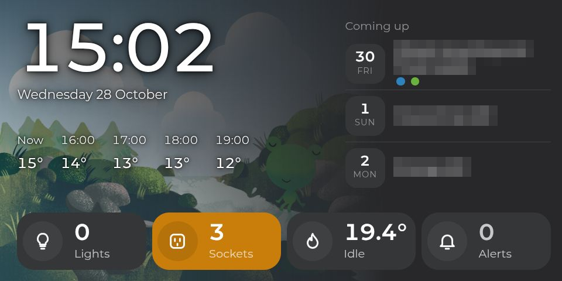
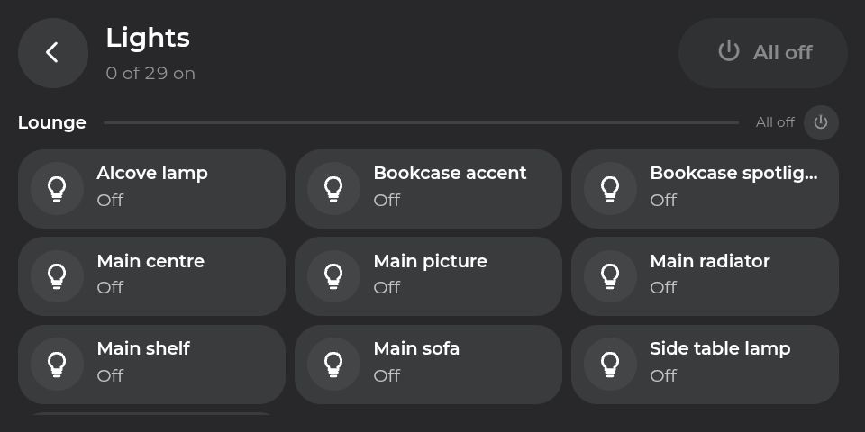
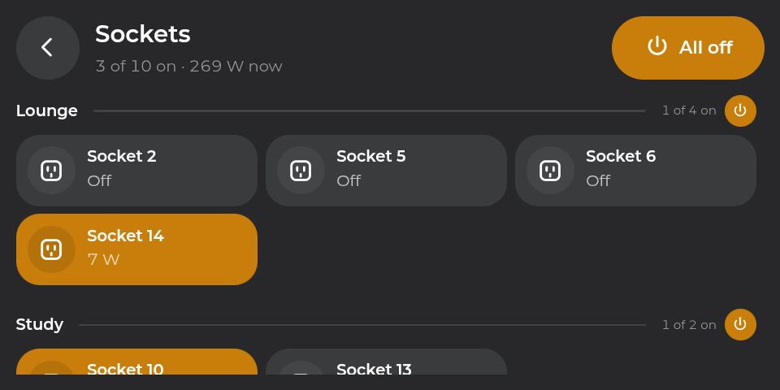
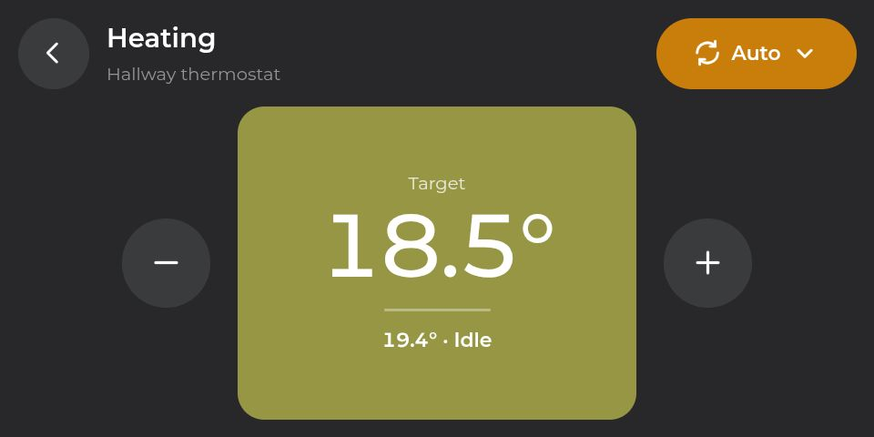
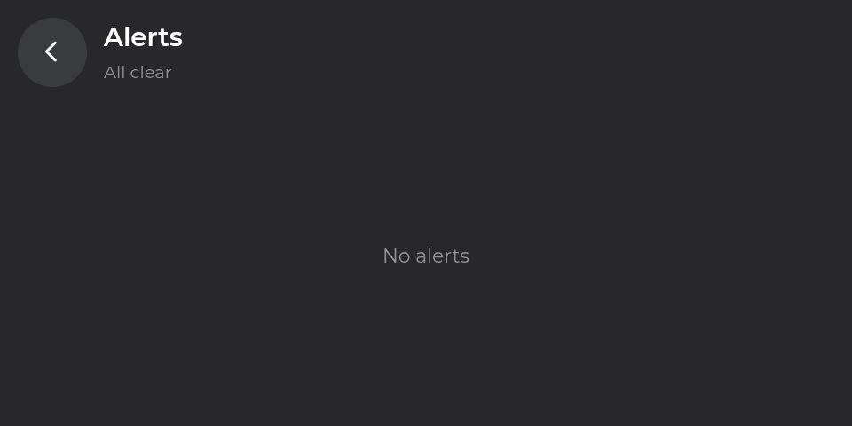

# Expressive Kiosk Card

A small-screen kiosk for Home Assistant in the style of [expressive-slider-card](https://github.com/drae/expressive-slider-card), [expressive-climate-card](https://github.com/drae/expressive-climate-card) and [expressive-schedule-card](https://github.com/drae/expressive-schedule-card). It was built for an Echo Show 5 running Kiosk Satellite, whose WebView is 788 × 394 CSS px. The card is meant to be read from across a room and spoken to more than touched.

One card is one screen. Put each on its own panel view:

- **Glance:** the clock, the next few hours of weather and what's coming up from your calendars. A Google Weather Frog scene sits behind the clock. Along the bottom are totals for lights on, sockets on, heating and alerts; each opens its own screen. While music plays, a now-playing tile with the cover and title replaces the weather row.
- **Lights** and **Sockets:** every labelled light or socket, grouped by area. Each group heading has the area's count and an Off disc. Tap a tile to toggle it. **All off** is in the header.
- **Heating:** − and + either side of a thermostat tile coloured by the target, using the same scale as the schedule card. The mode button opens the climate's modes, plus boost.
- **Alerts:** each active alert, with the doors or devices behind it.

It is a single plain JavaScript file with no dependencies.

## Screenshots

Taken on the Echo Show 5 at 960 × 480 device pixels. The calendar titles are blurred.

| | |
|---|---|
|  |  |
| Glance | Lights |
|  |  |
| Sockets | Heating |
|  | |
| Alerts | |

## Install

Add `https://github.com/drae/expressive-kiosk-card` to HACS as a custom repository of type **Dashboard** and download it. HACS registers the resource.

## Example

```yaml
type: custom:expressive-kiosk-card
view: glance
paths:
  glance: /kitchen-show/glance
  lights: /kitchen-show/lights
  sockets: /kitchen-show/sockets
  heating: /kitchen-show/heating
  alerts: /kitchen-show/alerts
climate: climate.thermostat
climate_name: Hallway thermostat
lights_count: sensor.count_lights_on
sockets_count: sensor.count_sockets_on
areas:
  - living_room
  - study
area_groups:
  living_room: light.lounge
locked:
  - switch.socket_11
alerts:
  - entity: binary_sensor.all_doors
    name: Door open
  - entity: sensor.garden_thermal_comfort_frost_risk
    name: Frost risk
    ok: no_risk
weather:
  condition: sensor.home_weather_condition
  now: sensor.weather_now
  hourly: sensor.weather_hourly
calendars:
  - entity: calendar.home
  - entity: calendar.bins
    strip: " collection"
    colors:
      recycling: rgb(46, 131, 191)
      food: rgb(105, 178, 63)
media:
  player: media_player.echo_show_kitchen
  now_playing: switch.echo_show_kitchen_now_playing
```

Give every view the same options and change only `view`.

## Options

| Option | Default | |
|---|---|---|
| `view` | `glance` | `glance`, `lights`, `sockets`, `heating` or `alerts` |
| `paths` | | Where each total and the back button go |
| `light_label` / `socket_label` | `light` / `socket` | Lights are labelled `light.*` entities and sockets are labelled `switch.*` entities. The area comes from the entity, or from its device |
| `areas` | | Area ids to put first; the others follow by name |
| `area_groups` | | A group entity per area. Off on an area, and All off, switch the group in one call instead of each member |
| `locked` | | Entities that are shown but never switched, including by All off |
| `lights_count` / `sockets_count` | | Count sensors for the Glance totals; counted from the labels when left out |
| `alerts` | | `entity`, `name` and optional `ok`. An alert is active when the entity is `on`, or when `ok` is given and the state isn't `ok`. A group lists its members that are on |
| `climate` / `climate_name` | | The thermostat and the name under the Heating title |
| `boost` | `minutes: 60`, `temperature: 21` | Boost uses `hive.boost_heating_on` when it exists, otherwise the climate's `boost` preset |
| `weather.condition` | | A Google Weather condition sensor; its `type` and `is_daytime` pick the frog scene |
| `weather.now` / `weather.hourly` | | `now_temp`, and a `forecast` attribute of `{dt, t}` hours |
| `weather.frog_path` | `/local/froggy/` | Where the [Google Weather Frog](https://github.com/Senexis/Google-Weather-Frog) layers live |
| `frog` | `fade: 0`, `size: 546`, `lift: 0`, `shadow: 1.2` | Where the scene starts fading (%), its size and lift (px), and the text shadow strength |
| `calendars` | | `entity`, optional `strip` (text removed from summaries) and `colors` (summary text → dot colour). Events on the same day from one calendar share a row |
| `media.player` / `media.now_playing` | | The player, and the switch that opens Kiosk Satellite's now-playing screen |

## Dashboard

Use panel views, one card each, and hide the HA header (for example with [kiosk-mode](https://github.com/NemesisRE/kiosk-mode)). Keep the dashboard free of anything else. The point of this card is a light page on a device with 1 GB of RAM.

## Tests

`npm test` runs the jsdom tests in `tests/`.

## Licence

BSD 3-Clause. The frog artwork is not included; see the Google Weather Frog project for its terms.
